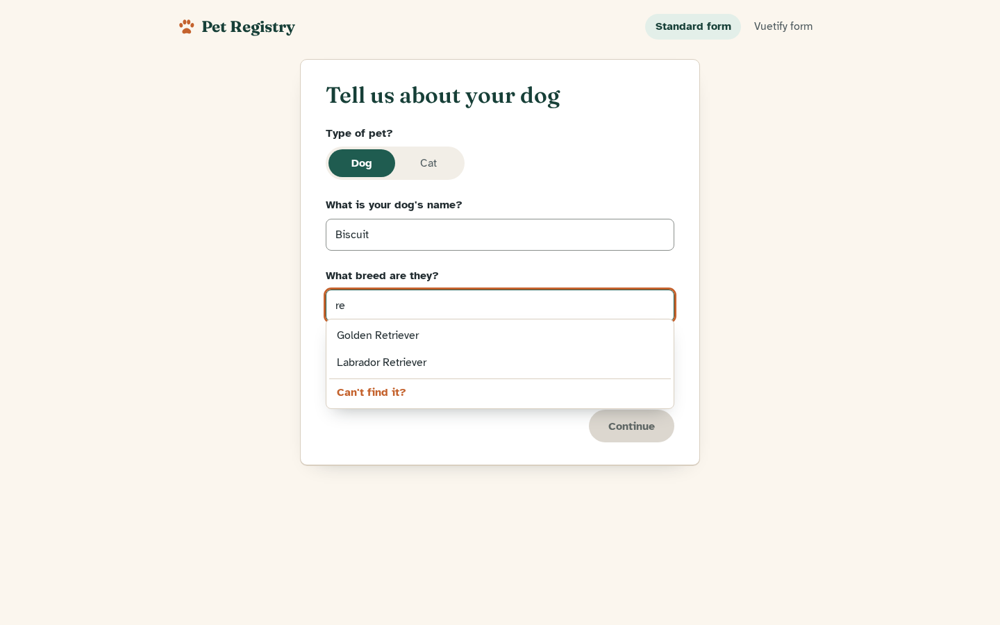
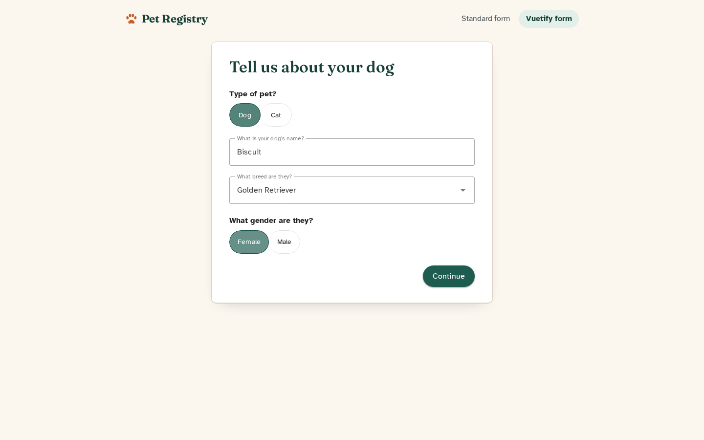
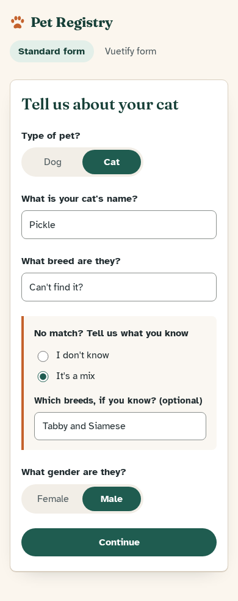
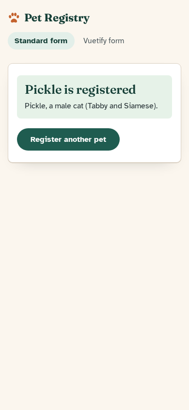
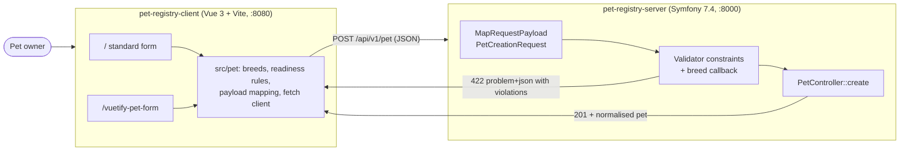

# Pet Registry

A small full-stack form for registering a dog or a cat. A pet owner answers four
questions (type, name, breed, gender), and a Symfony API validates the answers
and confirms the registration. The same form is built twice in the Vue client:
once by hand with plain HTML controls, and once with Vuetify components. Both
versions share one model, so they behave the same way and send the same payload.

The breed question has an escape hatch. If the breed isn't in the list, the
owner picks "Can't find it?" and then says whether the breed is unknown or a
mix. For a mix they can add a short description.

| Standard form (desktop) | Vuetify form (desktop) |
| --- | --- |
|  |  |

| Mixed breed (mobile) | Confirmation (mobile) |
| --- | --- |
|  |  |

The pets in the screenshots are made up, and the API was mocked while they were taken.

## How it fits together



- **`pet-registry-server/`** is a Symfony 7.4 micro-kernel app with one endpoint.
  `PetCreationRequest` holds the rules. Symfony maps the JSON body onto it,
  validates it, and turns any failure into a 422 response that names each field.
  Nothing is stored. The API's job ends at a validated, normalised record.
- **`pet-registry-client/`** is a Vue 3 app built with Vite. `src/pet/registration.js`
  holds the breed lists, the readiness rules and the API call.
  `src/pet/useRegistration.js` holds the form state that both forms use. When the
  API returns a 422, the client shows each message next to the matching field.

## Running it

You need Docker with Compose.

```sh
docker compose up --build
```

- Client: <http://localhost:8080> (standard form) and <http://localhost:8080/vuetify-pet-form>
- API: <http://localhost:8000/api/v1/pet> (POST only)

Stop it with `docker compose down`.

The API image copies `pet-registry-server/.env.example` to `.env` when no `.env`
exists. To change settings, create `pet-registry-server/.env` (or `.env.local`)
from the example. `APP_SECRET` is a placeholder there, so set your own value
before running the API anywhere but your machine. `CORS_ALLOW_ORIGIN` is a regex
of the browser origins allowed to call the API, localhost by default. The client
reads `VITE_API_URL` at build time and falls back to `http://localhost:8000`.

### Running the parts without Compose

API (PHP 8.4 and Composer):

```sh
cd pet-registry-server
cp .env.example .env
composer install
php -S 127.0.0.1:8000 -t public
```

Client (Node 22, pinned in `.nvmrc`):

```sh
cd pet-registry-client
npm ci
npm run dev        # http://localhost:8080
```

## Tests and checks

```sh
# API: 18 PHPUnit tests (functional tests through the kernel, plus the DTO)
cd pet-registry-server && cp -n .env.example .env && composer install && composer test

# Client: 31 Vitest tests, ESLint, production build
cd pet-registry-client && npm ci && npm test && npm run lint && npm run build
```

The API tests cover the happy paths for a dog, a mixed-breed cat and an unknown
breed. They also cover every validation rule, malformed JSON, the 405 on GET,
and the CORS preflight for an allowed and a foreign origin. The client tests
cover the payload mapping, the 422 handling, the breed combobox's keyboard
behaviour, and full submissions through both forms with `fetch` stubbed.

## API

`POST /api/v1/pet` takes one of two shapes: a `breed`, or a `breedFallback`
(`unknown` or `mix`). It never takes both.

| Field | Type | Rule |
| --- | --- | --- |
| `petType` | string | `dog` or `cat` |
| `petName` | string | not blank, at most 50 characters (trimmed) |
| `breed` | string or null | at most 60 characters. Required unless `breedFallback` is set |
| `breedFallback` | string or null | `unknown` or `mix`. Only when there is no `breed` |
| `mixDescription` | string or null | at most 100 characters. Only when `breedFallback` is `mix` |
| `gender` | string | `female` or `male` |

These responses were captured from the Compose stack:

```http
POST /api/v1/pet
Content-Type: application/json

{"petType":"dog","petName":"Biscuit","breed":"Beagle","gender":"female"}
```

```http
HTTP/1.1 201 Created
Content-Type: application/json

{"message":"Pet registered.","pet":{"petType":"dog","petName":"Biscuit","breed":"Beagle","breedFallback":null,"mixDescription":null,"gender":"female"}}
```

An invalid request gets every problem at once (the response is trimmed here):

```http
POST /api/v1/pet
Content-Type: application/json

{"petType":"cat","petName":"","breed":"Persian","breedFallback":"mix","gender":"female"}
```

```http
HTTP/1.1 422 Unprocessable Content
Content-Type: application/json

{
  "type": "https://symfony.com/errors/validation",
  "title": "Validation Failed",
  "status": 422,
  "violations": [
    {"propertyPath": "breed", "title": "Give a breed, or say that it is unknown or a mix."},
    {"propertyPath": "petName", "title": "Your pet's name cannot be empty."}
  ]
}
```

## Design notes

- **One model, two forms.** The hand-built form and the Vuetify form both get
  their state from `useRegistration()`. Building the request in one place keeps
  them from drifting apart, which is the point of comparing the two.
- **The rules live on the server.** The client only decides when Continue is
  enabled. The API checks again and returns messages in a form the client can
  show next to each field.
- **Accessible controls.** In the hand-built form, pet type and gender are real
  radio groups styled as pills. The breed picker is an ARIA combobox that works
  with the arrow keys, Enter and Escape. Every field has a label, and every focus
  state has a visible outline.
- **Tight CORS.** The API only answers browser origins that match
  `CORS_ALLOW_ORIGIN`, only on `/api/`, and only for POST and preflight requests.
- **No persistence.** Saving pets would need a database and an ownership model,
  and neither is part of this exercise.

## License

[MIT](LICENSE)
